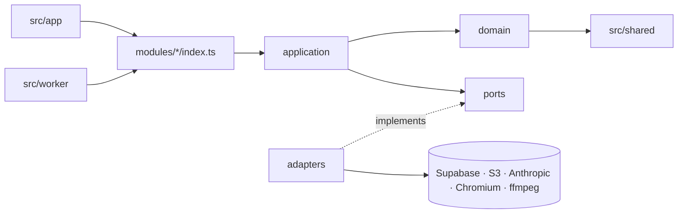
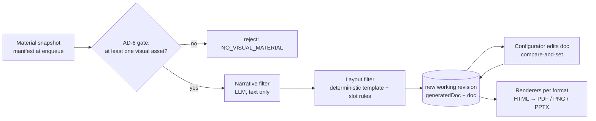
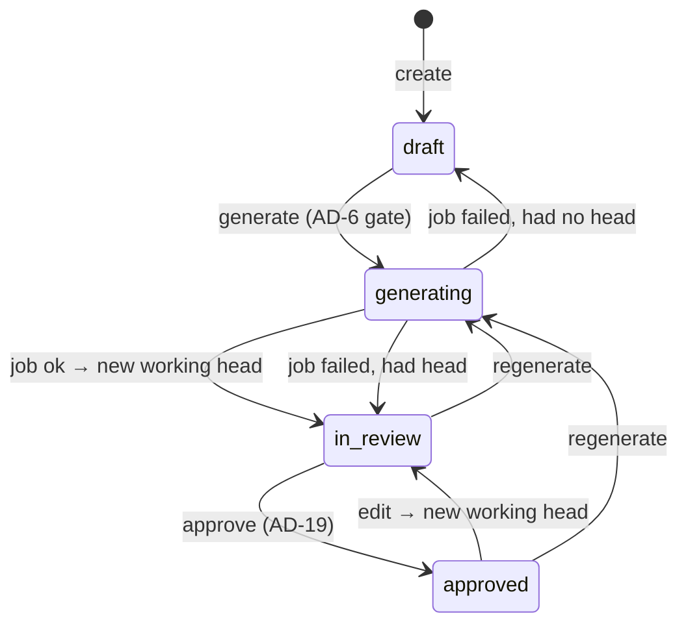
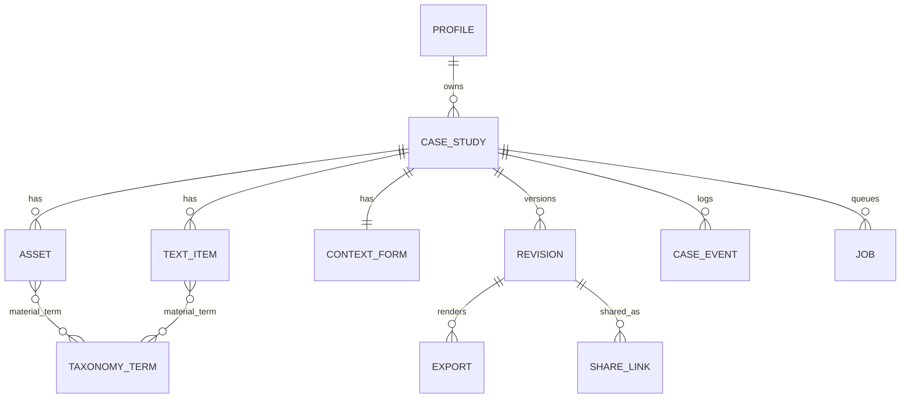
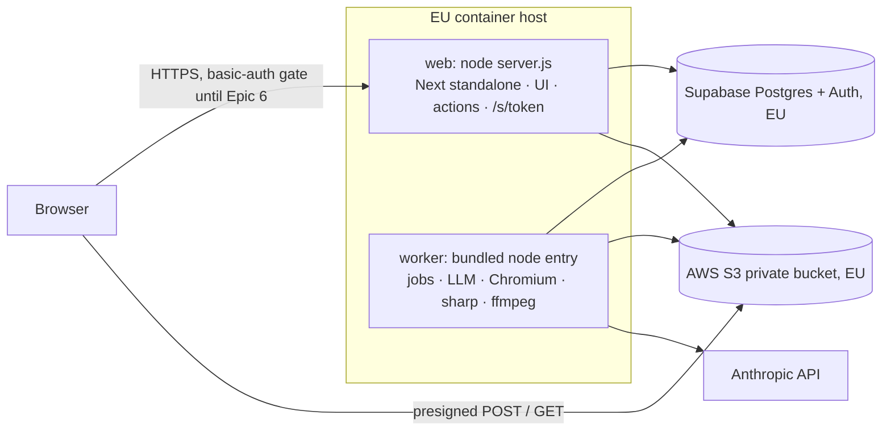

# Architecture Spine — MAC Recap MVP

## Design Paradigm

**Modular monolith.** One Next.js app plus one worker process, built from the same codebase. Each module has `domain/` (pure), `application/` (use cases) and `index.ts` (its public surface). A module adds `ports/` and `adapters/` **only where a vendor sits behind it** (Supabase, S3, Anthropic, Chromium, pptx, ffmpeg). Generation is a **pipes-and-filters** pipeline over one canonical document.

| Layer | Lives in | May import |
| --- | --- | --- |
| UI (pages, configurator, server actions, route handlers) | `src/app/**` | `modules/*/index.ts` only |
| Application (use cases, `authorize`, transitions) | `src/modules/<m>/application/` | own domain, other modules' `index.ts`, own ports |
| Domain (types, zod schemas, rules, guardrails) | `src/modules/<m>/domain/` | `src/shared/**` only (no I/O, no SDKs) |
| Adapters | `src/modules/<m>/adapters/` | own ports and domain, plus vendor SDKs |
| Worker entry | `src/worker/` | `modules/*/index.ts` only |





## Invariants & Rules

### AD-1 — Modules talk only through their public index

- **Binds:** all epics
- **Prevents:** Epic 4 or 5 reading Epic 2's tables or S3 keys directly, and vendor SDK calls leaking into UI code
- **Rule:** The MVP modules are `case-study`, `material` (which includes taxonomy), `generation`, `rendering`, `sharing`, `access` and `jobs`. `integration` is created at Epic 7 (AD-16). Each module owns the tables and S3 prefixes listed in the ownership table below, and nothing else writes them. Code outside a module imports only that module's `index.ts`. Vendor SDKs are imported only in `adapters/`.

| Owner | Tables | S3 prefixes |
| --- | --- | --- |
| `case-study` | `case_study`, `revision`, `case_event` | — |
| `material` | `asset`, `text_item`, `context_form`, `taxonomy_term`, `material_term` | `cases/{caseId}/assets/**` (originals and renditions) |
| `generation` | — (writes revisions only via `case-study`) | — |
| `rendering` | `export` | `cases/{caseId}/revisions/{revisionId}/exports/**` |
| `sharing` | `share_link` | — |
| `access` | `profile` | — |
| `jobs` | `job` | — |

### AD-2 — Case study ID is the permanent external key [ADOPTED]

- **Binds:** FR1, FR9-seam, `case-study`
- **Prevents:** a second "project code" competing with the ID when MAC Productive links in
- **Rule:** `case_study.id` is a uuid generated by the database, immutable, and never reused. It is the only identifier exposed to other systems. `case_study.project_order_ref` (nullable) is reserved for the MCP link and stays unset in the MVP.

### AD-3 — Case lifecycle and revision status, both owned by `case-study`

- **Binds:** FR5, FR6, FR7, Epics 3–5
- **Prevents:** epics disagreeing on what "approved" means while an approved case is being edited again, and status being set from more than one place
- **Rule:**
  - `case_study.status` (drawn below) is changed only by `case-study.transition(caseId, event, actor)`.
  - Each revision has its own `revision.status`, which is one of `working`, `approved` or `superseded`.
  - The case points to `head_revision_id` (the one being worked on) and `approved_revision_id` (the latest approved).
  - "Approved" always means `revision.status = 'approved'`, checked only through `case-study.isRevisionApproved(revisionId)`.
  - Approving freezes the head revision. The previous approved revision becomes `superseded`; links and exports that already point to it stay valid.
  - Editing an approved case creates a new `working` head and moves the case to `in_review`. Sales still see the case through `approved_revision_id` in the meantime.
  - A failed generation job leaves the head unchanged and returns the case to the state it was in before (`draft` or `in_review`).



UI labels: `draft` = Bozza · `generating` = In elaborazione · `in_review` = Da revisionare · `approved` = Approvato.

### AD-4 — `CaseStudyDocument` is the single source of truth for a generated case

- **Binds:** FR3, FR4, FR5, FR7, `generation`, `rendering`, configurator
- **Prevents:** different content per format, configurator edits that never reach exports, renderers re-querying raw material, and schema migrations rewriting frozen revisions
- **Rule:** Each revision stores two copies of the `CaseStudyDocument`, both jsonb and validated by the zod schema in `generation/domain`:
  - `generated_doc`: the pipeline's output, which is never changed afterwards.
  - `doc`: the copy the configurator edits.

  The document contains:
  - the narrative blocks (challenge, approach, result), each made of claims (AD-19);
  - `templateId@version`, the chosen variant and the layout seed (shuffle);
  - the canvas ratio;
  - the slot → `assetId` assignments;
  - the format list;
  - typography and spacing token choices.

  Renderers are pure functions of (document, template, asset URLs). A schema change bumps `schemaVersion` and adds an `upgrade(doc)` function. Documents are upgraded **when read** and the upgraded version is never written back to a non-working revision.

### AD-5 — Guardrails are code, not configuration [ADOPTED]

- **Binds:** NFR1, NFR3, Story 6.3, brief guardrails
- **Prevents:** an admin screen, environment variable or database flag that can loosen a guardrail, and the AI touching layout or assets
- **Rule:**
  - Guardrails are constants and checks in `src/modules/generation/domain/guardrails.ts`. Nothing reads them from the database, environment or UI, and there is no API to change them.
  - The LLM produces only narrative text fields.
  - Template choice, layout and slot assignment are deterministic code.
  - Asset bytes never go to an AI model or an AI transform. The only processing allowed is deterministic, non-destructive work done by `material` renditions: fit, crop, resize, and a poster frame or transcode for video.
  - The configurator can only pick token values the template defines.

### AD-6 — No visual material, no generation; the narrative is checked on both sides

- **Binds:** NFR5, FR3, Story 3.1, brief guardrail "no material = nothing generated", demo criterion "technical + graphic"
- **Prevents:** text-only case studies slipping into the MVP (that is FR10/Epic 8), and generated text that covers only one side of the project
- **Rule:**
  - `generate` fails with `NO_VISUAL_MATERIAL` before any LLM call unless the case has at least one visual asset (image or video) and the template's minimum media count is met.
  - The LLM receives only the case's material snapshot (AD-18). It gets no web or other server tools.
  - The structured output tags each claim with `aspect`, which is `technical` or `graphic`. Validation requires at least one claim of each aspect, or the generated draft is flagged in review as `MISSING_ASPECT`.

### AD-7 — One LLM port, one model setting, recorded per revision

- **Binds:** `generation`, FR3, NFR5
- **Prevents:** prompts or model IDs scattered across files, and text that can't be reproduced or audited
- **Rule:**
  - `NarrativeGenerator` is the only port that calls an LLM, and it runs only in the worker.
  - The adapter uses `@anthropic-ai/sdk` `client.beta.messages.parse` with the zod output schema and model `claude-opus-5-5`. It sets adaptive thinking, an explicit `effort: "high"`, and server-side refusal fallbacks (beta `server-side-fallback-2026-07-01`, `fallbacks: "default"`).
  - A `refusal` stop reason fails the job with code `LLM_REFUSAL`.
  - The model id lives in one constant. Prompts are versioned files in `generation/adapters/prompts/`.
  - Every revision records the served `response.model`, a `fellBack` flag, `promptVersion` and `schemaVersion`.

### AD-8 — Binaries live only in S3, behind presigned requests [ADOPTED: S3]

- **Binds:** FR2, FR7, Story 2.1, `material`, `rendering`, `sharing`
- **Prevents:** files spread across Supabase Storage and S3, large uploads through the app server, limits that can't be enforced, public URLs leaking client material, and two writers to the renditions prefix
- **Rule:**
  - The bucket is private, in the EU, with Block Public Access and versioning on. Its CORS rule allows only the app origin, for POST and GET.
  - The browser uploads directly with a **presigned POST** that the server issues after `authorize`. It carries `content-length-range` (100 MB maximum) and a `Content-Type` drawn from the allowlist in `material/domain/files.ts`: JPEG, PNG, WebP, MP4, MOV and PDF.
  - The S3 client that signs requests sets `requestChecksumCalculation: "WHEN_REQUIRED"`.
  - An asset row is created only after a HEAD check confirms the upload's size and type. Each case allows 20 files at most, checked on the server.
  - Reads use presigned GET, valid for 15 minutes at most.
  - Key layout, built only by the owning module's adapters:
    - `cases/{caseId}/assets/{assetId}/original.{ext}`
    - `cases/{caseId}/assets/{assetId}/renditions/{specHash}.{ext}`, owned by `material` and reached only through `material.getRendition(assetId, spec)`
    - `cases/{caseId}/revisions/{revisionId}/exports/{format}.{ext}`, owned by `rendering`
  - Supabase Storage is not used.

### AD-9 — One layout implementation; renders never pass through a public route

- **Binds:** FR3, FR4, FR7, `rendering`, Q1
- **Prevents:** the configurator preview drifting from the exports, each format reimplementing layout, and a print route that is either blocked by auth or publicly reachable
- **Rule:**
  - Each format in the format registry (`rendering/domain/formats.ts`: id, canvas size, page model, `static | motion`) has exactly one React renderer. The configurator preview, `/s/{token}` and exports all use it.
  - For an export, the worker renders HTML server-side (`renderToStaticMarkup`) and loads it into Playwright Chromium with `page.setContent`. **No print route exists.**
  - PDF and PNG come from that page. PPTX is built with pptxgenjs, one rendered PNG per slide. A ZIP bundles files that have already been rendered.
  - Video assets show as their poster frame in static formats. Motion formats such as social video 1080×1920 stay outside the registry until Q1 is decided.
  - `export` is unique on `(revision_id, format)` and immutable. Jobs call `rendering.ensureExport(revisionId, format)`, which returns the existing export if there is one.

### AD-10 — Long work runs as leased Postgres jobs in the worker

- **Binds:** generation, exports, renditions, `jobs`
- **Prevents:** generation or Chromium running inside a web request, a case left in `generating` after a worker crash, duplicate jobs from a double click, and a second queue technology
- **Rule:**
  - The job kinds are `generate`, `export` and `rendition`.
  - A job row has `kind`, `subject_id`, `input_hash`, `payload`, `status`, `attempts`, `max_attempts` (3), `locked_until` and `error`.
  - Enqueuing is an upsert against a partial unique index on `(kind, subject_id, input_hash) WHERE status IN ('queued','running')`, and returns the job that already exists.
  - The worker claims a job through the SQL function `jobs_claim()`, called by rpc, which uses `FOR UPDATE SKIP LOCKED` and sets a 10-minute lease. An expired lease is claimable again.
  - A job's result is accepted only if its `targetRevisionId` or head check still holds (AD-17).
  - Web requests never call the LLM, Chromium or ffmpeg.
  - The UI reads job outcomes through `jobs.getJobsFor(subjectId)` and the lifecycle through case status. Export failures never change case status.

### AD-11 — Authorization through one policy seam, from day one

- **Binds:** FR8, Epic 6, Stories 6.1–6.3, every server action, route and job
- **Prevents:** Epic 6 having to modify every endpoint built in Sprints 1–2, the browser reading tables directly, the worker having no actor, and the Epic 6 cutover leaving data owned by a placeholder user
- **Rule:**
  - Every server action and route handler calls `access.getActor()` and then `access.authorize(actor, action, resource)` before any use case.
  - The worker acts as the built-in `system` actor, which may perform only job events (`job_ok`, `job_failed`, renditions and exports).
  - All data access happens on the server with the Supabase **secret (service-role) key**. Only `src/shared/env.ts` and adapters can read that key.
  - The browser never queries Supabase tables. RLS is enabled on every table and denies all access to `anon` and `authenticated` as a backstop.
  - Before Sprint 3, `getActor()` returns a seeded dev `owner_designer` profile. Epic 6 swaps only the resolver (Supabase Auth session to `profile.role`) and reassigns that dev profile's rows to a named real profile.
  - The permission matrix, including whether each action applies to any resource or only the actor's own, lives in `access/domain/policy.ts`:

| Action | owner_designer | account_sales_social | admin | system |
| --- | --- | --- | --- | --- |
| create case | ✓ (becomes owner) | — | — | — |
| upload / tag / generate / edit | own cases | — | — | — |
| approve | own cases (AD-19) | — | — | — |
| list approved, export | any | any | — | export jobs |
| create share link | any approved | any approved | — | — |
| revoke share link | own links | own links | any | — |
| reassign case owner, manage users and roles | — | — | ✓ | — |
| change guardrails | — | — | — | — (AD-5) |

### AD-12 — Nothing is publicly reachable before real login; schema changes are forward-only

- **Binds:** deployment, Sprints 1–3, brief risk "real client data before login"
- **Prevents:** real client material being exposed on an open URL during Sprints 1–2, and environments drifting apart in schema
- **Rule:**
  - Until Epic 6 ships, every deployed environment sits behind HTTP basic auth in `proxy.ts`, with credentials from the environment. Share-link routes are gated too.
  - After Epic 6, the only unauthenticated route is `/s/{token}` (AD-13).
  - Migrations are SQL files in `supabase/migrations/` and are forward-only. They are applied with `supabase db push`, to staging first and then to prod, before the image that needs them is deployed.

### AD-13 — Share links point to frozen revisions and can be revoked

- **Binds:** FR7 / Story 5.2 ("publish" = shareable link), `sharing`
- **Prevents:** a link that changes content after it is shared, guessable URLs, and links nobody can revoke
- **Rule:**
  - A `share_link` row holds:
    - `token`: random, at least 128 bits, URL-safe
    - `revisionId`: must pass `isRevisionApproved` when the link is created
    - `createdBy`
    - `expiresAt` (nullable)
    - `revokedAt` (nullable)
    - `accessMode`
  - `/s/{token}` renders that revision read-only through the AD-9 renderer, with media served by presigned GET. A revoked or expired token returns 404.
  - A superseded revision keeps working for links that already point to it.
  - The schema supports `unlisted`, `unlisted_expiring` and `login_required`. Which one is the default is Q5.

### AD-14 — Tags, properties and flags are reference data with stable keys

- **Binds:** FR2, Story 2.4, FR4, `material`
- **Prevents:** free-text tags, labels hard-coded in layout rules, and renames breaking generation
- **Rule:** Every value is a row in `taxonomy_term` (`kind` ∈ tag|property|flag, a stable `key`, a `label`), seeded through migrations. Material links to terms through `material_term`. Code, templates and prompts refer to terms only by `key`, never by label. The value list is Q2.

### AD-15 — Templates are versioned code and the versions only ever get added

- **Binds:** FR3, FR4, Story 3.2, owner/designer "maintains templates"
- **Prevents:** template design changing at runtime (NFR1), two ways of defining layout rules, and old approved revisions crashing after a template refactor
- **Rule:**
  - A template version is a folder, `src/modules/rendering/templates/{templateId}/v{n}/`. It holds the variants, the slots, the **media-count rules** (the supported range and the slot mapping for each count), the allowed tokens and one renderer per supported format.
  - A published version is never edited or deleted. A change ships as `v{n+1}`.
  - The designer supplies template designs and rules, and a developer turns them into code. In the tool, owner/designer chooses the template, variant, shuffle, canvas ratio and tokens.

### AD-16 — MAC Productive is reached only through `integration`

- **Binds:** FR9, FR10 (later), Epic 7
- **Prevents:** MCP calls appearing inside MVP modules, and a data model shaped by a system that isn't ready
- **Rule:** No MVP code calls MAC Productive. Epic 7 creates `src/modules/integration`, which is the only module allowed to, and maps external data to `material` and `case-study` inputs keyed by `case_study.id`. The direction of the MCP connection is deferred.

### AD-17 — Revision writes use compare-and-set; regeneration always creates a new revision

- **Binds:** Epics 3–4, configurator, `generate` jobs
- **Prevents:** a configurator save and a regenerate job overwriting each other, and an older job that finishes last replacing newer work
- **Rule:**
  - Every write to `revision.doc` passes the expected `revision.version` and fails with `STALE_REVISION` on a mismatch.
  - Edits are rejected while the case is `generating`.
  - Only `working` revisions are writable.
  - A `generate` job records `baseHeadRevisionId` when it is enqueued. On success it creates a **new** working revision, which carries over the configurator choices (template, variant, tokens, canvas ratio) where they are still valid. The old head becomes `superseded`. The result is accepted only if the head is still `baseHeadRevisionId`; otherwise it is discarded.

### AD-18 — Material is referenced by typed refs and snapshotted per revision

- **Binds:** FR2, FR3, NFR2, `material`, `generation`
- **Prevents:** generation inventing ids for form fields, uploads arriving mid-job being included at random, and deleting an asset breaking approved revisions or the evidence a reviewer checked
- **Rule:**
  - Material is referred to only as `MaterialRef { kind: 'asset' | 'text' | 'form_field', id }`, where form fields have stable keys. Refs are resolved only through `material.resolveRefs(caseId, refs)`.
  - A `generate` job's payload carries a material manifest (refs plus content hashes) taken when it is enqueued. The revision stores that manifest.
  - Material that a non-working revision references can only be soft-deleted (`deleted_at`).
  - Uploading or tagging never changes case status. New material is used only by the next generation.

### AD-19 — Approval is owner-only and every claim has a recorded provenance [ADOPTED]

- **Binds:** FR6, NFR2, addendum guardrails "human review mandatory, by whoever uploaded the visual material", demo criterion "every claim traceable"
- **Prevents:** someone other than the uploader approving, a support flag going stale after an edit, and text a human added bypassing the traceability check
- **Rule:**
  - Only the case owner can upload to a case and approve it. The owner is the creator unless an admin reassigns the case.
  - Each claim stores `provenance` (`generated`, `human_edited` or `human_added`), `sourceRefs: MaterialRef[]`, and `reviewerAssertedBy` (nullable).
  - Server validation rejects refs that are unknown or not in the manifest.
  - Approval is computed **when someone approves**: every claim must have at least one ref that resolves, or a `reviewerAssertedBy` set on its current text. Editing a claim's text clears that assertion.
  - Approval also requires that no `MISSING_ASPECT` flag is open (AD-6).
  - The person reviewing the text remains the control for NFR2.

### AD-20 — Every lifecycle step is an event, so the validation metrics can be measured

- **Binds:** 8-week validation metrics (owner time, amount of manual editing, hallucinations caught), `case-study`
- **Prevents:** metrics that can't be computed after the fact, and each epic logging in its own way
- **Rule:**
  - `case-study` appends a row to `case_event` (`case_id`, `revision_id`, `actor_id`, `type`, `at`, `data`) on every transition, upload confirmation, configurator save, claim edit or assertion, export and share-link creation. Rows are append-only and are never updated.
  - Owner hands-on time is measured from the first upload event to approval.
  - Editing effort is the difference between `generated_doc` and the approved `doc`.

## Consistency Conventions

| Concern | Convention |
| --- | --- |
| Naming | Database: snake_case, singular table names. TypeScript: camelCase fields, PascalCase types, kebab-case files. Module folder = module name in AD-1. |
| IDs | uuid everywhere (`gen_random_uuid()`), share token excepted (AD-13). Never expose sequential ids. |
| Dates | `timestamptz` stored in UTC. ISO-8601 strings across the wire. Displayed in Europe/Rome. |
| Validation | zod schemas in `domain/` are the single definition. Database types come from `npm run db:types` (`supabase gen types`) into `src/shared/db.types.ts`, which adapters only may import. |
| Errors | Use cases return `Result<T, AppError>`, where `AppError = { code: SCREAMING_SNAKE, message, details? }`. Route handlers map this to HTTP status plus `{ error: AppError }`. Never throw across module boundaries. |
| Mutation | Only through application use cases. Lifecycle changes go through `case-study.transition` (AD-3). Revision writes use compare-and-set (AD-17). Every mutation emits a `case_event` (AD-20). |
| Logging | Structured JSON to stdout with `caseId`, `jobId` and `actorId` where they apply. No asset bytes, text material or prompts in logs. |
| Config | Environment variables read only in `src/shared/env.ts` (validated by zod). Secrets never get the `NEXT_PUBLIC_` prefix. Guardrails are never configurable (AD-5). |
| Language | UI copy in Italian through one dictionary file. Narrative language is set per case (`case_study.locale` ∈ it\|en, default `it`). |
| Next.js | `cacheComponents` is off. All tool pages are dynamic and server-rendered. |

## Stack

Starter: `npx create-next-app -e with-supabase`. The starter currently ships `next: latest`, Tailwind 3.4, TypeScript 5 and `cacheComponents: true`, so the **first story pins every version below exactly**, upgrades Tailwind to 4, and turns `cacheComponents` off.

| Name | Version |
| --- | --- |
| Node.js | 24 LTS |
| TypeScript | 6.0.3 |
| Next.js (App Router, `output: standalone`) | 16.3.8 |
| React | 19.3.0 |
| Tailwind CSS / shadcn | 4.3.3 / 4.21.4 |
| Supabase (Postgres + Auth), `@supabase/supabase-js` / `@supabase/ssr` / CLI | 2.117.3 / 0.12.7 / 2.120.0 |
| AWS S3, `@aws-sdk/client-s3` + `s3-presigned-post` + `s3-request-presigner` | 3.1147.0 |
| `@anthropic-ai/sdk`, model `claude-opus-5-5` | 0.132.1 |
| zod | 4.6.5 |
| Playwright (Chromium, worker only; base image `mcr.microsoft.com/playwright`) | 1.63.0 |
| pptxgenjs | 4.0.1 |
| sharp / ffmpeg (renditions, worker only) | 0.35.5 / 7.x from the base image |

## Structural Seed





There is one image, built on the Playwright base image. It contains the Next standalone output (start command `node server.js`) and a separately bundled worker (start command `node dist/worker.js`) with its full dependencies. Environments are `local` (Supabase CLI stack and a dev bucket), `staging` (the demo environment, gated per AD-12) and `prod` (from Epic 6). Each environment has its own Supabase project and its own bucket.

```text
src/
  app/                      # (tool)/… pages and actions, s/[token]
  modules/
    case-study/ material/ generation/ rendering/ sharing/ access/ jobs/
      domain/ application/ index.ts   (+ ports/ adapters/ only at vendor seams)
    rendering/templates/{templateId}/v{n}/
  worker/                   # job loop entry
  shared/                   # env.ts, result.ts, db.types.ts, i18n
supabase/migrations/        # forward-only SQL, incl. jobs_claim()
```

## Capability → Architecture Map

| Capability | Lives in | Governed by |
| --- | --- | --- |
| FR1 unique ID | `case-study` | AD-2 |
| FR2 upload, tags, properties, flags | `material` | AD-8, AD-14, AD-18 |
| FR3 generate from templates | `generation`, `jobs` | AD-4, AD-5, AD-6, AD-7, AD-10, AD-17 |
| FR4 adapt to media count | `rendering/templates` | AD-15 |
| FR5 review dashboard and configurator | `app/(tool)`, `case-study` | AD-3, AD-4, AD-17 |
| FR6 approval | `case-study` | AD-3, AD-19 |
| FR7 export and share link | `rendering`, `sharing`, `jobs` | AD-9, AD-10, AD-13 |
| FR8 login and roles | `access` | AD-11, AD-12 |
| NFR1 / NFR3 guardrails | `generation/domain/guardrails.ts`, `access/domain/policy.ts` | AD-5, AD-11 |
| NFR2 hallucination check | review UI + human | AD-18, AD-19 |
| NFR4 15-20 minutes, validation metrics | async jobs, `case_event` | AD-10, AD-20 |
| NFR5 narrative structure | `generation` | AD-6, AD-7 |
| FR9 MAC Productive seam | `integration` (Epic 7) | AD-2, AD-16 |

## Deferred

- **Export format list (Q1).** The registry (AD-9) takes formats one at a time. Motion formats (social video) need a decision on video rendering. Decide before the Epic 3 templates are final.
- **Taxonomy values (Q2).** The structure is fixed (AD-14). Seed the values before Story 2.4.
- **Narrative prompt and quality checklist (Q3).** Content in `generation/adapters/prompts/`, due with Sprint 2's "narrative structure and quality criteria".
- **Default share-link access mode (Q5).** The schema supports every option (AD-13). This is a client-confidentiality decision and needs an answer before Epic 5 ships.
- **Container host provider.** Any EU host that can run one image with two processes. Choose by end of Sprint 1, before the first staging deploy.
- **Editable PPTX.** Image slides for the MVP. pptxgenjs has had no release since 2025-06; review this if editable slides become a requirement.
- **Notification when a draft is ready.** In-app polling for the MVP. Email or Slack later, through a new `notify` port.
- **Sign-in method.** Supabase Auth email and password or magic link in Epic 6. Microsoft SSO can be added later without changing AD-11.
- **MCP direction and data contract (PRD open point 7).** Decided when MAC Productive is ready (AD-16).
- **Observability beyond defaults.** Stdout logs, Supabase daily backups and S3 versioning until real usage after the 8-week validation.
- **Attribution of inbound contacts and upsells (Q4).** Not an MVP system concern. If needed, share-link view counts can be added as `case_event` types.
