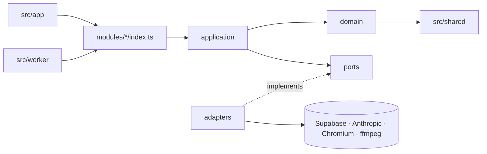
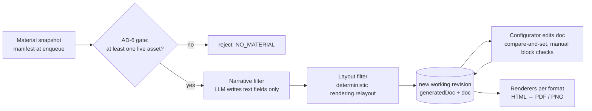
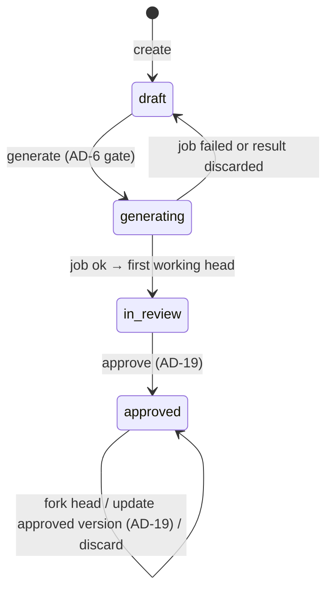
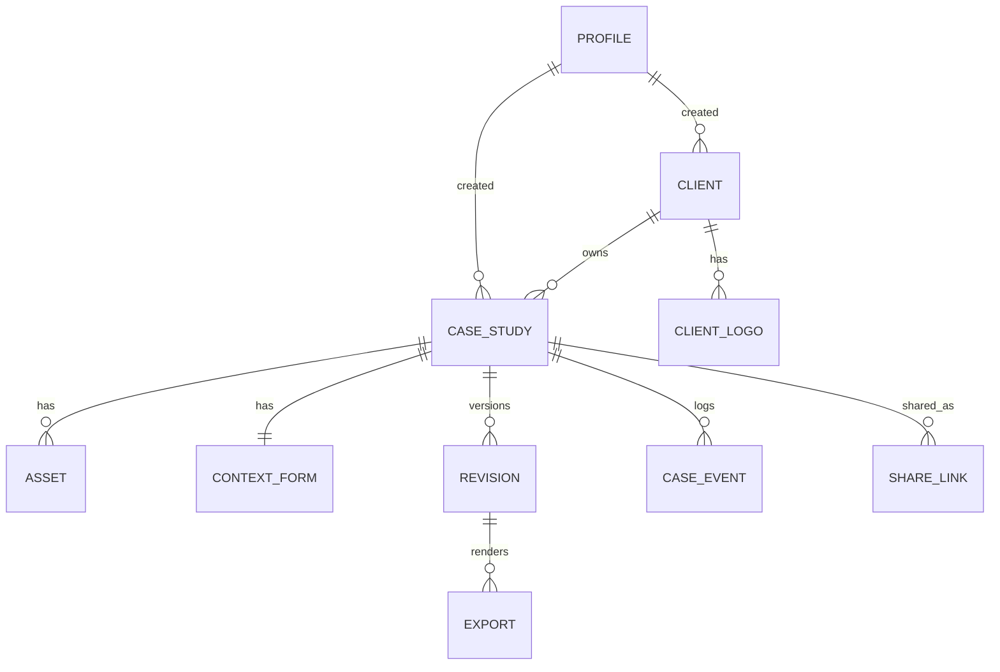
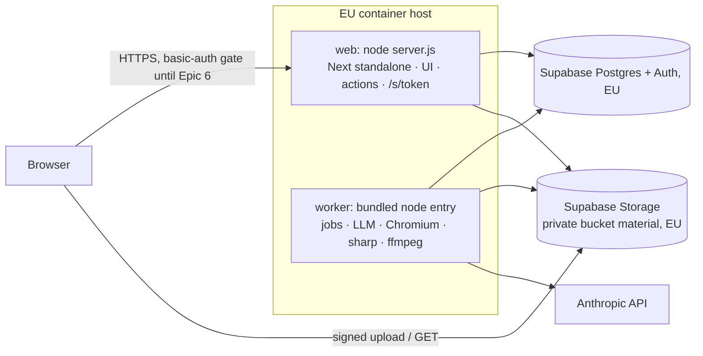

# Architecture Spine — MAC Recap MVP

Open-point references (OP n) use the PRD v2 numbering. `[CONFLICT An]` marks a tension with PRD v2 or the UX specs that the spine does not settle on its own; see *Conflicts flagged*.

## Design Paradigm

**Modular monolith.** One Next.js app plus one worker process, built from the same codebase. Each module has `domain/` (pure), `application/` (use cases) and `index.ts` (its public surface). A module adds `ports/` and `adapters/` **only where a vendor sits behind it** (Supabase, Anthropic, Chromium, ffmpeg). Generation is a **pipes-and-filters** pipeline over one canonical document.

| Layer | Lives in | May import |
| --- | --- | --- |
| UI (pages, configurator, server actions, route handlers) | `src/app/**` | `modules/*/index.ts` only |
| Application (use cases, `authorize`, transitions) | `src/modules/<m>/application/` | own domain, other modules' `index.ts`, own ports |
| Domain (types, zod schemas, rules, guardrails) | `src/modules/<m>/domain/` | `src/shared/**` only (no I/O, no SDKs) |
| Adapters | `src/modules/<m>/adapters/` | own ports and domain, plus vendor SDKs |
| Worker entry | `src/worker/` | `modules/*/index.ts` only |





## Invariants & Rules

### AD-1 — Modules talk only through their public index

- **Binds:** all epics
- **Prevents:** Epic 4 or 5 reading Epic 2's tables or storage keys directly, and vendor SDK calls leaking into UI code
- **Rule:** The MVP modules are `case-study`, `material`, `generation`, `rendering`, `sharing`, `access` and `jobs`. `integration` is created at Epic 7 (AD-16). Each module owns the tables and storage prefixes listed below, and nothing else writes them. Code outside a module imports only that module's `index.ts`. Vendor SDKs are imported only in `adapters/`.

| Owner | Tables | Storage prefixes |
| --- | --- | --- |
| `case-study` | `case_study`, `client`, `client_logo`, `case_number_counter`, `revision`, `case_event` | `clients/{clientId}/logos/**` |
| `material` | `asset` (including `is_favourite`), `context_form` | `cases/{caseId}/assets/**` (originals and renditions) |
| `generation` | — (writes revisions only via `case-study`) | — |
| `rendering` | `export`, `template_variant_state` (only if AD-15's conditional applies) | `cases/{caseId}/revisions/{revisionId}/exports/**` |
| `sharing` | `share_link` | — |
| `access` | `profile` | — |
| `jobs` | `job` | — |

### AD-2 — Case study ID is the permanent external key [ADOPTED]

- **Binds:** FR1, FR9-seam, `case-study`
- **Prevents:** a second "project code" competing with the ID when MAC Productive links in
- **Rule:** `case_study.id` is a uuid generated by the database, immutable, and never reused. It is the only identifier exposed to other systems. `case_study.project_order_ref` (nullable) is reserved for the MCP link and stays unset in the MVP.
  The readable case history code (AD-21) is a display field: never a key, never in URLs or APIs to other systems, and not a substitute for the project-order link.

### AD-3 — Case lifecycle and revision status, both owned by `case-study`

- **Binds:** FR5, FR6, FR7, NFR7, Story 4.3, Epics 3–5
- **Prevents:** epics disagreeing on what "approved" means while an approved case is being edited again, unchecked text reaching a shareable link, and status being set from more than one place
- **Rule:**
  - `case_study.status` (drawn below) is changed only by `case-study.transition(caseId, event, actor)`.
  - Each revision has its own `revision.status`: `working`, `approved` or `superseded`.
  - The case points to `head_revision_id` (the one being worked on) and `approved_revision_id` (the live approved one, null until the first approval). Every change to either pointer is a compare-and-set on `case_study.head_version` (AD-17).
  - "Approved" always means `revision.status = 'approved'`, checked only through `case-study.isRevisionApproved(revisionId)`. Export and share use cases require it (NFR7).
  - **Reads name the revision they need.** `case-study` exposes `getLiveRevision(caseId)` (the approved revision) and `getEditableRevision(caseId)` (the head). The library, case study view, exports and `/s/{token}` use only `getLiveRevision`. Only the configurator and Check tab read the head.
  - **`approved` is terminal for the case status** (Story 4.3). Editing an approved case forks a new `working` head from `approved_revision_id` (AD-17); the case stays `approved`, and every live read keeps serving the approved revision until an owner/designer runs **Update approved version**, which is the same `approve` use case (AD-19) applied to the head. The head becomes the approved revision and the previous one becomes `superseded`. `[CONFLICT A1]`
  - **Discard changes** and **Update approved version** exist only while the head differs from the approved revision. Discard marks the working head `superseded` and points `head_revision_id` back to `approved_revision_id`.
  - Generation is available only from `draft`. A failed generation job, or a result discarded under AD-17, returns the case to `draft` with its material and details intact.
  - Delete is allowed only in `draft` and is a soft delete (`deleted_at`).
  - The stored state set and its labels depend on OP 8; the revision model does not.



UI labels follow whichever OP 8 option is chosen. `[ASSUMPTION]` Interim, from EXPERIENCE.md Option A: `draft` = Bozza · `generating` = In elaborazione · `in_review` = Da approvare · `approved` = Approvato. Shareable links are a count on approved cases, not a status.

### AD-4 — `CaseStudyDocument` is the single source of truth for a generated case

- **Binds:** FR3, FR4, FR5, FR7, `generation`, `rendering`, configurator
- **Prevents:** different content per format, configurator edits that never reach exports, a layout setting stored once in the configurator and per format in the renderer, renderers re-querying raw material, and schema migrations rewriting frozen revisions
- **Rule:** Each revision stores two copies of the `CaseStudyDocument`, both jsonb and validated by the zod schema in `generation/domain`:
  - `generated_doc`: the pipeline's output, which is never changed afterwards.
  - `doc`: the copy the configurator edits.

  The document has a **shared** part and a **per-format** part:
  - Shared: `templateId@version`; the text blocks, each with a stable `blockId` and its claims and check state (AD-19); the selected media set. The block set (challenge, approach, result, plus the headline and KPI tiles) is defined once per template, not per format, so the Check tab and `approve` see the same blocks.
  - Per format, keyed by format id: the layout variant, the slot → `assetId` assignments, spacing, text scale and font pairing, all drawn from the values the template allows. A revision's per-format entries are exactly the registry formats when the revision was created; export, share and approve reject any other format with `FORMAT_NOT_IN_REVISION`.
  - There is no canvas-ratio field. The format registry owns the ratio.
  - The shared part also holds `about` (AD-22): the client's name, sector, description and logo id, copied from the snapshot by code. It is not a text block: no check, no claims, not editable.
  - The challenge / approach / result sections cannot be removed or reordered; the schema rejects a document that lacks one.
  - Slot assignments are computed only by the pure `rendering.relayout(doc, template)`. The pipeline calls it, and every change to the media set calls it in the same write.

  Renderers are pure functions of (document, format, template, asset URLs). A schema change bumps `schemaVersion` and adds an `upgrade(doc)` function. Documents are upgraded **when read** and the upgraded version is never written back to a non-working revision.

  The shared/per-format split follows an `[ASSUMPTION]` in EXPERIENCE.md; if UX changes it, this AD changes with it.

### AD-5 — Guardrails are code, not configuration [ADOPTED]

- **Binds:** NFR1–NFR7, Story 6.3, the Sprint 2 and Sprint 3 guardrail checks
- **Prevents:** an admin screen, environment variable or database flag that can loosen a guardrail, the AI touching layout or assets, and a guardrail that can't be checked before login exists
- **Rule:**
  - Guardrails are constants and checks in `src/modules/generation/domain/guardrails.ts`, `access/domain/policy.ts` (AD-11) and the `case-study` approve, export and share preconditions (AD-3, AD-19). Nothing reads them from the database, environment or UI, and there is no API to change them. No role, admin included, has a setting that disables or changes NFR1–NFR7.
  - The LLM produces only narrative text fields. Template choice, layout and slot assignment are deterministic code. Which material types the LLM may read (for example images through vision) is OP 2; the LLM never returns or modifies an asset.
  - Asset bytes are never modified by AI. The only processing allowed is deterministic work done by `material` renditions: downscaled copies of the whole image (never upscaled, cropped, recoloured or filtered), and a poster frame or transcode for video. Whether fitting media into each export format counts as altering, and whether crop or a focal point is allowed, is OP 12; until then neither crop nor focal point exists.
  - The configurator can only pick values the template defines.
  - Each guardrail (NFR6 gate, NFR7 approved-only export and share, no AI on assets, no guardrail setting) is enforced in a use case and covered by an automated test, so the **first guardrail check at the end of Sprint 2** runs against the pre-login build. NFR3 is checked again after Epic 6.

### AD-6 — No material, no generation; the narrative is checked on both sides

- **Binds:** NFR6, NFR5, FR3, Story 3.1
- **Prevents:** generation from the details form alone, and the gate disagreeing with the UI's Generate button
- **Rule:**
  - `generate` fails with `NO_MATERIAL` before any LLM call unless the case has at least one non-deleted asset of any allowed type (image, video, text document, PDF). Typed text lives only in the details form, which never counts (NFR6). The wizard's Generate button and the worker (again, when it claims the job) use the same check through `material.index`.
  - The template's media-count rule (AD-15) then picks the layout. What a template renders with zero images or videos is a template rule the design team supplies (see Deferred).
  - The LLM receives only the case's material snapshot, form answers and the client snapshot's name, sector and description (AD-18, AD-22). Client info never counts as material. It gets no web or other server tools.
  - The structured output tags each claim with `aspect`, `technical` or `graphic`. A draft without both aspects is marked `MISSING_ASPECT` and the warning is shown in the configurator. It does not block approval. `[CONFLICT A3]`

### AD-7 — One LLM port, one model setting, recorded per revision

- **Binds:** `generation`, FR3, NFR5
- **Prevents:** prompts or model IDs scattered across files, and text that can't be reproduced or audited
- **Rule:**
  - `NarrativeGenerator` is the only port that calls an LLM, and it runs only in the worker.
  - The adapter uses `@anthropic-ai/sdk` `client.beta.messages.parse` with the zod output schema and model `claude-opus-5-5`. It sets adaptive thinking, an explicit `effort: "high"` in `output_config` next to `format`, and server-side refusal fallbacks (beta `server-side-fallback-2026-07-01`, `fallbacks: "default"`).
  - A `refusal` stop reason fails the job with code `LLM_REFUSAL`.
  - The model id lives in one constant. Prompts are versioned files in `generation/adapters/prompts/`. Their content depends on OP 2 and the Sprint 2 quality checklist (NFR5).
  - Every revision records the served `response.model`, a `fellBack` flag, `promptVersion` and `schemaVersion`.

### AD-8 — Binaries live only in Supabase Storage, behind signed requests [ADOPTED: Supabase Storage]

- **Binds:** FR2, FR7, Story 2.1, Story 2.11, `material`, `rendering`, `sharing`
- **Prevents:** binaries spread across two stores, large uploads through the app server, limits that can't be enforced, public URLs leaking client material, and two writers to the renditions prefix
- **Rule:**
  - Adopted 2026-10-14 in place of AWS S3 ([storage proposal](../../sprint-change-proposal-2026-10-14-storage.md)).
  - The bucket `material` is private, in the project's EU region, and created by a migration. Supabase enforces its limits on every upload: `file_size_limit` 50 MB, and `allowed_mime_types` set to the allowlist in `material/domain/files.ts`: JPEG, PNG, WebP, MP4, MOV, PDF, plain text, Markdown and DOCX `[ASSUMPTION: text types]`.
  - The browser uploads directly to a **signed upload URL** that the server issues after `authorize`, having checked the declared size and type.
  - An asset row is created only after the server re-checks the upload's size and type from the object's metadata at confirm. A case holds at most 20 non-deleted files, checked on the server when the signed upload URL is issued and again at confirmation (FR2).
  - Reads use signed GET URLs, valid for 15 minutes at most.
  - The service role is the only reader and writer. There is no public access and no policy for `anon` or `authenticated`.
  - The bucket has no versioning, so the app never deletes objects. Removing a file is a soft delete of its row (AR18), and the object stays.
  - Key layout, built only by the owning module's adapters:
    - `cases/{caseId}/assets/{assetId}/original.{ext}`
    - `cases/{caseId}/assets/{assetId}/renditions/{specHash}.{ext}`, owned by `material` and reached only through `material.getRendition(assetId, spec)`
    - `cases/{caseId}/revisions/{revisionId}/exports/{format}.{ext}`, owned by `rendering`
    - `clients/{clientId}/logos/{logoId}.{ext}`, owned by `case-study` (AD-22). Logos are PNG, JPEG or WebP, at most 5 MB and at least 400 px on the short side, checked when the signed upload URL is issued and again at confirm.
  - The per-file limit is 50 MB because the hosted Supabase plan caps uploads at 50 MB (verified 2026-10-14). Moving to 100 MB needs the Pro plan, a raised project upload limit, a bucket migration and `MAX_FILE_BYTES`.

### AD-9 — One layout implementation; renders never pass through a public route

- **Binds:** FR3, FR4, FR7, `rendering`, OP 1
- **Prevents:** the configurator preview drifting from the exports and the shared link page, each format reimplementing layout, and a print route that is either blocked by auth or publicly reachable
- **Rule:**
  - Each format in the format registry (`rendering/domain/formats.ts`: id, name, ratio, pixel size, page model, file type, `static | motion`) has exactly one React renderer. The configurator, the case study view, `/s/{token}` and exports all use it and the same format list.
  - For an export, the worker renders HTML server-side (`renderToStaticMarkup`) and loads it into Playwright Chromium with `page.setContent`. **No print route exists.**
  - File types: deck and A4 → PDF; image formats → ZIP of PNGs `[ASSUMPTION, from UX]`; **Export all** → one ZIP, stored as export `(revision_id, 'all')`, built only after `ensureExport` has produced every format of that same revision. No PPTX in the MVP (UX decision).
  - Video assets show as their poster frame in static formats. Motion formats (social video 9:16) stay out of the registry until OP 1 adds them.
  - `export` is unique on `(revision_id, format)` and immutable. Jobs call `rendering.ensureExport(revisionId, format)`, which returns the existing export if there is one.

### AD-10 — Long work runs as leased Postgres jobs in the worker

- **Binds:** generation, exports, renditions, `jobs`, NFR4
- **Prevents:** generation or Chromium running inside a web request, a case left in `generating` after a worker crash, duplicate jobs from a double click, and a second queue technology
- **Rule:**
  - The job kinds are `generate`, `export` and `rendition`.
  - A job row has `kind`, `subject_id`, `input_hash`, `payload`, `status`, `attempts`, `max_attempts` (3), `locked_until` and `error`.
  - Enqueuing is an upsert against a partial unique index on `(kind, subject_id, input_hash) WHERE status IN ('queued','running')`, and returns the job that already exists.
  - The worker claims a job through the SQL function `jobs_claim()`, called by rpc, which uses `FOR UPDATE SKIP LOCKED` and sets a 10-minute lease. The worker renews the lease every minute while the job runs, so the lease only detects a crashed worker and is never a time limit (NFR4: generation time is unbounded). An expired lease is claimable again.
  - When a lease expires with `attempts = max_attempts`, `jobs_claim()` marks the job `failed` and the worker emits `job_failed`, so no case stays in `generating`.
  - A job's result is accepted only if its `targetRevisionId` or head check still holds (AD-17).
  - Web requests never call the LLM, Chromium or ffmpeg.
  - The UI reads job outcomes through `jobs.getJobsFor(subjectId)` and the lifecycle through case status. Export failures never change case status.

### AD-11 — Authorization through one policy seam with fixed role permissions

- **Binds:** FR8, Epic 6, Stories 6.1–6.3, every server action, route and job
- **Prevents:** Epic 6 having to modify every endpoint built in Sprints 1–2, the browser reading tables directly, the worker having no actor, permissions stored as data an admin could change, and a role change that lingers in a session token
- **Rule:**
  - Every server action and route handler calls `access.getActor()` and then `access.authorize(actor, action, resource)` before any use case.
  - The permission matrix below lives only in `access/domain/policy.ts`. There is no permissions table and no API to change it (Story 6.2). The admin changes only `profile.role`.
  - `getActor()` reads the role from `profile` on every request, never from a cached token claim, so a role change applies at the user's next request.
  - The worker acts as the built-in `system` actor, a seeded `profile` row with role `system` that the admin cannot assign. It may perform only job work: create a working revision from a generate result through `case-study`, emit `job_ok` and `job_failed`, and write renditions and exports.
  - All data access happens on the server with the Supabase **secret (service-role) key**. Only `src/shared/env.ts` and adapters can read that key.
  - The browser never queries Supabase tables. RLS is enabled on every table and denies all access to `anon` and `authenticated` as a backstop.
  - Before Sprint 3, `getActor()` returns a seeded dev `owner_designer` profile. Epic 6 swaps only the resolver (Supabase Auth session to `profile.role`). Records made by the dev profile keep it as their actor; it is disabled at cutover, never reassigned, so `case_event` stays append-only and pre-login approvals are not credited to a real person.
  - Removing a user disables their `profile` (`disabled_at`); their cases, links and events stay.

| Action | owner_designer | account_sales_social | admin | system |
| --- | --- | --- | --- | --- |
| list cases | all statuses | approved only | — | — |
| create case, upload, mark favourites, fill details, generate, edit | any case | — | — | — |
| list clients | ✓ | — | — | — |
| manage clients (add, rename) | ✓ | — | — | — |
| delete case | any `draft` case | — | — | — |
| approve, update approved version, discard | any case (AD-19) | — | — | — |
| view, export | any approved | any approved | — | — |
| job work (generate result, renditions, exports) | — | — | — | ✓ |
| create shareable link | any approved | any approved | — | — |
| turn off shareable link | any link `[ASSUMPTION]` | any link `[ASSUMPTION]` | — | — |
| manage templates (AD-15) | ✓ | — | — | — |
| manage users and assign roles | — | — | ✓ (not the last admin's own role) | — |
| change permissions or guardrails | — | — | — | — (AD-5) |

### AD-12 — Nothing is publicly reachable before real login; schema changes are forward-only

- **Binds:** deployment, Sprints 1–3, PRD known risk "real client material before login"
- **Prevents:** real client material being exposed on an open URL during Sprints 1–2, and environments drifting apart in schema
- **Rule:**
  - Until Epic 6 ships, every deployed environment sits behind HTTP basic auth in `proxy.ts`, with credentials from the environment. Shareable-link routes are gated too. `[CONFLICT A2]`
  - After Epic 6, the only unauthenticated route is `/s/{token}` (AD-13).
  - Migrations are SQL files in `supabase/migrations/` and are forward-only. They are applied with `supabase db push`, to staging first and then to prod, before the image that needs them is deployed.

### AD-13 — Shareable links follow the live approved version and can be turned off

- **Binds:** FR7, NFR7, Story 4.3, Story 5.2, `sharing`, OP 11
- **Prevents:** a link that keeps showing an outdated version after an update (or one that shows unapproved work), guessable URLs, links nobody can turn off, and a link page that becomes a side door around export
- **Rule:**
  - A `share_link` row holds:
    - `token`: random, at least 128 bits, URL-safe
    - `caseId` and `format` (one format per link)
    - `createdBy`, `createdAt`
    - `expiresAt` (nullable), `revokedAt` (nullable)
    - `accessMode`
  - Creating a link requires the case to have an `approved_revision_id`.
  - `/s/{token}` resolves the case through `getLiveRevision` (AD-3) at request time and renders it read-only through the AD-9 renderer. It never serves a working or superseded revision. A turned-off or expired token returns the "no longer available" page.
  - The page offers no file download `[ASSUMPTION, from UX]`, and its media are display-size renditions and video poster frames or transcodes served by signed GET, never originals.
  - `accessMode` is an enum. Until OP 11 is decided its only value in use is `unlisted`: anyone with the link can open it (FR7). The modes OP 11 adds (expiry, login, password or other) are added to the enum then; `expiresAt` already exists.

### AD-14 — Favourite is a property of an image or video asset

- **Binds:** FR2, PRD Story 2.4, `material`, OP 14
- **Prevents:** favourites on files that can't be shown as media, a favourite change moving a case's status, and generation depending on a mark whose meaning isn't decided
- **Rule:**
  - `asset.is_favourite` (boolean, default false) is settable only on image and video assets, through `material.index`. Any number of assets per case can be favourites.
  - Setting it records an event and never changes case status.
  - It is carried in the material manifest, and generation ignores it until OP 14 is decided.
  - There is no taxonomy. Tags, properties and flags were dropped on 2026-10-14 (OP 3 resolved; [Sprint Change Proposal](../../sprint-change-proposal-2026-10-14.md)).

### AD-15 — Templates are versioned code and the versions only ever get added

- **Binds:** FR3, FR4, Story 3.2, owner/designer "manage templates", OP 12
- **Prevents:** template design changing at runtime (NFR1), two ways of defining layout rules, old approved revisions crashing after a template refactor, and generation and Shuffle disagreeing on which variants exist
- **Rule:**
  - A template version is a folder, `src/modules/rendering/templates/{templateId}/v{n}/`. It holds, per format, the variants, the slots, the **media-count rules** (the supported range and the slot mapping for each count), the allowed values (spacing ranges, text scales, font pairings) and one renderer per supported format.
  - A published version is never edited or deleted. A change ships as `v{n+1}`.
  - The design team supplies template designs and rules, and a developer turns them into code. In the tool, the owner/designer chooses variant, shuffle, spacing, text scale and font pairing per format.
  - Generation and Shuffle get the list of usable variants only from `rendering.listVariants(templateId, format, mediaCount)`.
  - *Conditional on C4 (EXPERIENCE.md):* if variants can be turned on and off in the tool, the on/off state is a row in `template_variant_state` owned by `rendering`, `listVariants` filters on it, and at least one variant per format stays on. Template design is never stored in the database.
  - Whether layout adaptation and Shuffle count as altering (OP 12) can remove Shuffle or narrow the variant lists; it does not change this structure.

### AD-16 — MAC Productive is reached only through `integration`

- **Binds:** FR9, FR10 (later), Epic 7, OP 7
- **Prevents:** MCP calls appearing inside MVP modules, and a data model shaped by a system that isn't ready
- **Rule:** No MVP code calls MAC Productive. Epic 7 creates `src/modules/integration`, which is the only module allowed to, and maps external data to `material` and `case-study` inputs keyed by `case_study.id`. The direction of the MCP connection is deferred.

### AD-17 — Revision writes use compare-and-set; regeneration always creates a new revision

- **Binds:** Epics 3–4, configurator, `generate` jobs
- **Prevents:** two owner/designers, or a configurator save and a regenerate job, overwriting each other, and an older job that finishes last replacing newer work
- **Rule:**
  - Every write to `revision.doc`, block checks included, passes the expected `revision.version` and fails with `STALE_REVISION` on a mismatch. The client does not retry a `STALE_REVISION`; it reloads the revision. The configurator sends its writes one at a time.
  - Every change to `head_revision_id` or `approved_revision_id` (fork, generate result, approve, update approved version, discard) passes the expected `case_study.head_version` and fails with `STALE_HEAD` on a mismatch.
  - Edits are rejected while the case is `generating`.
  - Only `working` revisions are writable; a write to any other revision fails with `REVISION_NOT_WRITABLE` and the client reloads. Saves never fork. Forking is the explicit, idempotent `case-study.forkHead(caseId, expectedHeadVersion)`, which copies only from `approved_revision_id` and returns the existing working head if there is one.
  - A `generate` job records `baseHeadVersion` when it is enqueued. On success it creates a **new** working revision, never overwriting an existing one, and sets the head by compare-and-set against `baseHeadVersion`; on a mismatch the result is discarded (AD-3).

### AD-18 — Material is referenced by typed refs and snapshotted per revision

- **Binds:** FR2, FR3, NFR2, NFR6, `material`, `generation`, OP 2
- **Prevents:** generation inventing ids for form fields, uploads arriving mid-job being included at random, and deleting an asset breaking approved revisions or the material drawer a reviewer uses
- **Rule:**
  - Material is referred to only as `MaterialRef { kind: 'asset' | 'form_field', id }`, where form fields have stable keys. Refs are resolved only through `material.resolveRefs(caseId, refs)`. A `form_field` ref is a valid source for a claim (NFR2) but never counts as material (AD-6). A `client_field` ref (`description` or `sector`, AD-22) resolves from the revision's client snapshot and follows the same rule.
  - A `generate` job's payload carries a material manifest (refs plus content hashes) taken when it is enqueued. The revision stores that manifest.
  - How each material type is turned into LLM input is a `generation` adapter concern decided with OP 2; it does not change the ref or manifest shape. Known limits: a request is capped at 32 MB and PDFs at 600 pages, DOCX is not an API input, and video is not an API input. A file over those limits goes in as extracted text or split. The Anthropic Files API is not used, because it stores client material at Anthropic.
  - Material that any revision or any queued or running job references can only be soft-deleted (`deleted_at`). `approve` fails with `MATERIAL_MISSING` if anything the revision references is deleted. The UI offers no restore.
  - Uploading or marking a favourite never changes case status. New material is used only by the next generation.

### AD-19 — Approval by any owner/designer after a manual check of every block [ADOPTED]

- **Binds:** FR5, FR6, NFR2, NFR7, Story 4.3, demo criterion "every claim traceable"
- **Prevents:** approval without a person checking every block, a check that stays ticked after the text changes, and the tool's own grounding data being treated as the check
- **Rule:**
  - Any owner/designer can approve a case or update its approved version (FR6). There is no case-level owner gate.
  - Each text block in `doc` carries `check: { by, at, textHash } | null`, keyed by its `blockId` (AD-4). Setting it is a person's action in the Check tab; nothing sets it automatically, and there is no bulk "check all" use case.
  - A check counts only while its `textHash` matches the block's current text, so any text change voids it. A forked working head (AD-3) keeps the checks of unedited blocks.
  - `approve(caseId, revisionId, expectedRevisionVersion, expectedHeadVersion)` approves exactly that version, so a colleague's later save makes it fail with `STALE_REVISION`. It requires every block to have a current check, computed on the server at approve time.
  - Text overflow also blocks approval. The configurator measures it with the AD-9 renderer for **every** format of the revision and sends the result with the approve call for that same revision version; `approve` rejects a call without an overflow-free result for each format. The server does not re-measure (see Deferred).
  - Each claim also stores `provenance` (`generated`, `human_edited`, `human_added`) and optional `sourceRefs: MaterialRef[]` from generation. Server validation rejects refs that are unknown or not in the manifest. `sourceRefs` never satisfy the approval check and are never shown as "verified" or "unsupported" (NFR2 is a manual step).
  - `approve` records the approver in `case_event` (AD-20).

### AD-20 — Every lifecycle step is an event, kept for the validation measures

- **Binds:** 8-week validation measures, `case-study`, OP 13
- **Prevents:** measures that can't be reconstructed after the fact, each epic logging in its own way, and elapsed time being reported as hands-on time
- **Rule:**
  - `case-study` appends a row to `case_event` (`case_id`, `revision_id`, `actor_id`, `type`, `at`, `data`) on every transition, upload confirmation, configurator save, block check or uncheck, claim edit, approval, export, link creation and link turn-off. Rows are append-only and are never updated.
  - Editing effort is derivable as the difference between `generated_doc` and the approved `doc`.
  - Elapsed time between events is **not** owner/designer hands-on time (NFR4 excludes waiting). The tool does not record hands-on time (UX); how the 8-week measures are recorded is OP 13.

### AD-21 — A case history's readable code is fixed at creation and unique

- **Binds:** FR1, PRD Stories 2.2 and 2.5, `case-study` ([Sprint Change Proposal 2026-10-15](../../sprint-change-proposal-2026-10-15.md))
- **Prevents:** duplicate or shifting codes, codes that depend on client spelling, and two people getting the same number
- **Rule:**
  1. **Client code letters.** Strip accents (`unaccent`) and uppercase. Remove dots, then drop these whole-word legal suffixes: SRL, SRLS, SPA, SAPA, SAS, SNC, SS, SCARL, SCRL, SCPA, COOP, ONLUS, ETS, APS, GMBH, AG, KG, LTD, LLC, LLP, INC, CORP, CO, SA, SARL, SL, BV, NV, PLC. If that leaves no letters, keep them. Keep only the letters A–Z of the remaining words, joined. Pad to 3 letters with `X`, so "3M" gives `MXX`.
  2. **Client name key.** Trim, collapse whitespace, lowercase and strip accents. It is unique, so a second client with the same key is `CLIENT_NAME_TAKEN`.
  3. **Client code.** It is the first free code among these candidates, in order:
     - the first 3 letters
     - the first 4 letters (when the name has 4 or more)
     - the first 3 letters plus A, then B, through Z

     If every candidate is taken, the create fails with `CLIENT_CODE_EXHAUSTED`. `create_client` takes a transaction-level advisory lock, so two clients created at once can't get the same code. A unique index is the backstop. The code is always automatic, can't be edited, doesn't change when the name changes, and clients are never deleted.
  4. **Case number.** Each (client, case year) pair counts from 1, restarting each year. `create_case_study` increments `case_number_counter` with `insert … on conflict do update … returning`. That row lock serialises concurrent creates for the same client and year only. A unique key on (`client_id`, `year`, `number`) is the backstop.
  5. **Fixed and never reused.** Code and number are stored when the case is created. A later change to the case's client or year, or to the client's name, doesn't change them, and a trigger blocks any update. Soft-deleted cases keep their numbers, so a number is never reused and gaps can appear. A failed create rolls the counter back with it.
  6. **Format.** `{clientCode}-{year}-{number}`, with the number padded to at least 2 digits and no upper limit (`LUM-2026-01`, `LUM-2026-100`). It is unique across all cases.
  7. **Single definition.** These rules live once, in SQL (`client_code_letters`, `create_client`, `create_case_study`), used by both the data migration and the app. The TypeScript domain only validates the name length (1–120) and never computes codes.
  8. **Where it shows.** The code appears in the app's tables, wizard and library. It is not shown on the shared link page or in exports.

### AD-22 — Client info is copied into each revision when it is generated

- **Binds:** FR3 (amended), PRD Story 2.5, `case-study`, `generation`, `rendering` ([Sprint Change Proposal 2026-10-16](../../sprint-change-proposal-2026-10-16.md))
- **Prevents:** an approved case history changing because a client was edited, an About block that differs between formats, the LLM rewriting the client's own words, and a missing logo breaking an old revision
- **Rule:**
  1. `client.description` (≤400) and `client.sector` (≤60) are optional plain text. `client.logo_id` points to a `client_logo` row. Rows in `client_logo` are never updated or deleted.
  2. When a `generate` job is enqueued, `case-study.getClientSnapshot(caseId)` (`{ clientId, name, sector, description, logoId }`) is copied into the job payload. The revision stores it in its manifest.
  3. The document's `about` block is filled by code from the snapshot. The LLM never writes it. It is `null` when the snapshot has no description, sector or logo.
  4. Editing the client never changes an existing revision, whatever its status. The new values reach a case only at its next generation.
  5. Every template fits the maximum description length in every format, so the About block can never cause an overflow that blocks approval.
  6. The About block appears in every format, export and shared link, like the rest of the document. AD-21 rule 8 (no case code there) is unchanged.

## Consistency Conventions

| Concern | Convention |
| --- | --- |
| Naming | Database: snake_case, singular table names. TypeScript: camelCase fields, PascalCase types, kebab-case files. Module folder = module name in AD-1. |
| IDs | uuid everywhere (`gen_random_uuid()`), share token excepted (AD-13). Never expose sequential ids as keys or in URLs; the case history code (AD-21) is the one human-readable display code. |
| Dates | `timestamptz` stored in UTC. ISO-8601 strings across the wire. Displayed in Europe/Rome. |
| Validation | zod schemas in `domain/` are the single definition. Database types come from `npm run db:types` (`supabase gen types`) into `src/shared/db.types.ts`, which adapters only may import. |
| Errors | Use cases return `Result<T, AppError>`, where `AppError = { code: SCREAMING_SNAKE, message, details? }`. Route handlers map this to HTTP status plus `{ error: AppError }`. Never throw across module boundaries. |
| Mutation | Only through application use cases. Lifecycle changes go through `case-study.transition` (AD-3). Revision writes use compare-and-set (AD-17). Every mutation emits a `case_event` (AD-20). Client changes are not case events (no case exists); `client` keeps `created_by` and `updated_at`. |
| Logging | Structured JSON to stdout with `caseId`, `jobId` and `actorId` where they apply. No asset bytes, text material or prompts in logs. |
| Config | Environment variables read only in `src/shared/env.ts` (validated by zod). Secrets never get the `NEXT_PUBLIC_` prefix. Guardrails and permissions are never configurable (AD-5, AD-11). |
| Language | UI copy in Italian through one dictionary file (decided in UX). Narrative language is set per case (`case_study.locale` ∈ it\|en, default `it`) `[ASSUMPTION]`. |
| Next.js | `cacheComponents` is off. All tool pages are dynamic and server-rendered. |

## Stack

Starter: `npx create-next-app -e with-supabase`. The starter currently ships `next: latest`, Tailwind 3.4, TypeScript 5 and `cacheComponents: true`, so the **first story pins every version below exactly**, upgrades Tailwind to 4, and turns `cacheComponents` off.

| Name | Version |
| --- | --- |
| Node.js | 24 LTS |
| TypeScript | 6.0.3 |
| Next.js (App Router, `output: standalone`) | 16.3.8 |
| React / react-dom | 19.3.0 |
| Tailwind CSS / shadcn | 4.3.3 / 4.21.4 |
| Supabase (Postgres + Auth + Storage), `@supabase/supabase-js` / `@supabase/ssr` / CLI | 2.117.3 / 0.12.7 / 2.120.0 |
| `@anthropic-ai/sdk`, model `claude-opus-5-5` | 0.132.1 |
| zod | 4.6.5 |
| Playwright (Chromium, worker only; base image `mcr.microsoft.com/playwright:v1.63.0-noble`) | 1.63.0 |
| sharp (renditions, worker only) | 0.35.5 |
| ffmpeg (worker only) | installed and pinned explicitly in the Dockerfile; the Playwright image ships only its own recording build. Version fixed in the first story |

## Structural Seed





There is one image, built on the Playwright base image `mcr.microsoft.com/playwright:v1.63.0-noble` (ships Node 24). It contains the Next standalone output (start command `node server.js`) and a separately bundled worker (start command `node dist/worker.js`) with its full dependencies. Environments are `local` (Supabase CLI stack, including its storage), `staging` (the demo environment, gated per AD-12) and `prod` (from Epic 6). Each environment has its own Supabase project, with its own `material` bucket created by migration.

```text
src/
  app/                      # (tool)/… pages and actions, s/[token]
  modules/
    case-study/ material/ generation/ rendering/ sharing/ access/ jobs/
      domain/ application/ index.ts   (+ ports/ adapters/ only at vendor seams)
    rendering/templates/{templateId}/v{n}/
  worker/                   # job loop entry
  shared/                   # env.ts, result.ts, db.types.ts, i18n
supabase/migrations/        # forward-only SQL, incl. jobs_claim()
```

## Capability → Architecture Map

| Capability | Lives in | Governed by |
| --- | --- | --- |
| FR1 unique ID, readable code, client | `case-study` | AD-2, AD-21 |
| FR2 upload (20 × 50 MB), favourites, details form | `material` | AD-8, AD-14, AD-18 |
| FR3 generate from templates, only from material, form answers and client info; About the client block | `generation`, `jobs`, `case-study` | AD-4, AD-5, AD-6, AD-7, AD-10, AD-17, AD-22 |
| FR4 adapt to media count | `rendering/templates` | AD-15 |
| FR5 review dashboard and configurator, text editing | `app/(tool)`, `case-study` | AD-3, AD-4, AD-17, AD-19 |
| FR6 approval by any owner/designer | `case-study` | AD-3, AD-19 |
| FR7 export and shareable link, both roles | `rendering`, `sharing`, `jobs` | AD-9, AD-10, AD-11, AD-13 |
| FR8 login and fixed roles | `access` | AD-11, AD-12 |
| NFR1 / NFR3 guardrails, no guardrail setting | `generation/domain/guardrails.ts`, `access/domain/policy.ts` | AD-5, AD-11 |
| NFR2 manual claim check | Check tab + `case-study.approve` | AD-18, AD-19 |
| NFR4 ≤ 20 min hands-on (target 15; NFR2 wins), waiting excluded | async jobs keep waiting off the hands-on path | AD-10, AD-20 (measurement: OP 13) |
| NFR5 narrative structure, both sides | `generation` | AD-4, AD-6, AD-7 |
| NFR6 no material, no generation | `generation` gate + wizard | AD-6 |
| NFR7 approval before export or share | `case-study`, `rendering`, `sharing` | AD-3, AD-13, AD-19 |
| FR9 MAC Productive seam | `integration` (Epic 7) | AD-2, AD-16 |

## Conflicts flagged

Not resolved by this spine. Each AD carries an interim rule so building can continue; the owner named below decides.

- **A1 — Live edits vs the claim check (AD-3, AD-13, AD-19). Owner: PRD owner.** Story 4.3 says saved changes to an approved case study update it and its links. Read literally, every autosave would reach clients' links before the edited block is re-checked, against NFR2 and NFR7. The spine follows EXPERIENCE.md C1: edits are staged on a working head and go live, status still approved, at **Update approved version**. If the PRD owner wants edits live on save, AD-3 and AD-19 need rework.
- **A2 — Shareable links before login (AD-12). Owner: PRD owner.** FR7 says anyone with a link can open it until OP 11. AD-12 keeps the whole environment, `/s/{token}` included, behind basic auth until Epic 6, because Epic 5 (Sprint 2) ships before login and real client material is in the tool. Before Epic 6 a link opens only for people who have the basic-auth credentials. Choosing to open `/s/{token}` from Epic 5 is a one-line change to the gate.
- **A3 — `MISSING_ASPECT` (AD-6). Owner: UX.** NFR5 requires both the technical and the graphic side. The spine detects a draft missing one side, but EXPERIENCE.md has no such warning and gates Approve only on block checks and overflow. Interim: shown as a warning, not blocking. UX decides where it appears and whether it blocks.
- **A4 — Generation with no images or videos (AD-6). Owner: design team.** NFR6 and the wizard allow generation from texts or PDFs alone. The v1 spine required a visual asset, which is stricter than the PRD and has been dropped. Graphic templates still need a rule for zero media items (a text-only variant, or PDF page renditions as media; the latter is an OP 12 question).
- **A5 — Concurrent editing (AD-17). Owner: UX.** Any owner/designer can edit any case and there is no review assignment, so two people can edit the same revision. The server rejects the second save with `STALE_REVISION`; EXPERIENCE.md's autosave states have no "someone else changed this" state.

## Open-point dependencies

| PRD open point | Architecture that depends on it | Stable regardless |
| --- | --- | --- |
| OP 1 export formats | AD-9 format registry entries, AD-15 template formats, motion formats | renderer-per-format, export uniqueness, file types |
| OP 2 data processing logic | AD-7 prompt content, AD-18 per-type LLM input (PDF, DOCX, video) | port, manifest and ref shapes |
| OP 3 taxonomy | Resolved 2026-10-14: dropped, no taxonomy (AD-14) | — |
| OP 4 account/sales/social journey (browsing) | library queries over `getLiveRevision` | approved-only listing (AD-11) |
| OP 8 status lifecycle | AD-3 stored state set and labels | revision model, approved is terminal |
| OP 11 link access | AD-13 default `accessMode`, expiry UI, AD-12 after Epic 6 | token, case + format link, turn-off |
| OP 12 what counts as altering | AD-5 rendition operations (fitting into export formats, crop, focal point, PDF pages as media), AD-15 Shuffle and media-count adaptation | no AI modifies assets, no upscaling, template versions in code |
| OP 13 recording the measures | AD-20 use of the event log | append-only `case_event` |
| OP 14 what a favourite means for generation | AD-14 use of `is_favourite` in generation (AD-7 prompt, AD-18 manifest) | `asset.is_favourite`, carried in the manifest |

## Deferred

- **Container host provider.** Any EU host that can run one image with two processes. Choose by end of Sprint 1, before the first staging deploy.
- **Server-side overflow check.** The configurator measures every format with the shared renderer and sends the result with `approve` (AD-19). The server trusts that result in the MVP; add a worker-side measure if overflowing text reaches an approved version.
- **Text extraction for DOCX and PDF.** A `material` or `generation` adapter, library chosen in Story 2.3 or with OP 2 and verified then.
- **Editable PPTX.** Not in the MVP (deck exports as PDF). Revisit if a client needs editable slides.
- **Template maintenance scope (C4).** AD-15 holds either way; the variant on/off table is built only if the PRD owner adopts the UX scope.
- **Regenerate.** Not offered by the UX, so generation runs only from `draft` (AD-3). Material added to a case in review or approved is used through Replace media. If a regenerate is added later, AD-17's generate rule already covers it.
- **Anthropic data handling beyond the demo.** The demo material's NDA was cleared for the Anthropic API. Each project run in the 8-week validation needs the same clearance; zero data retention is to be checked with Anthropic before then.
- **Notification when a draft is ready.** In-app toast via polling for the MVP. Email or Slack later, through a new `notify` port.
- **Sign-in method.** Supabase Auth email and password or magic link in Epic 6. Microsoft SSO can be added later without changing AD-11.
- **MCP direction and data contract (OP 7).** Decided when MAC Productive is ready (AD-16).
- **Observability beyond defaults.** Stdout logs and Supabase daily backups until real usage (storage has no versioning; the app never deletes objects, AD-8) after the 8-week validation.
- **Attribution of inbound contacts and upsells (OP 10).** Not an MVP system concern. If needed, link views can be added as `case_event` types.
